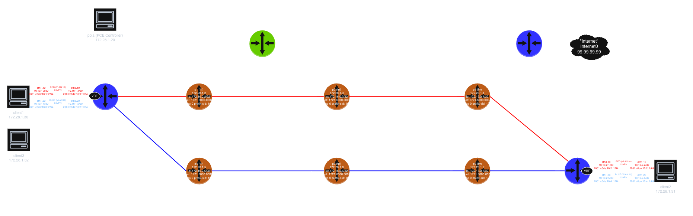

# clab-frr-sr-mpls

## Overview

A Segment Routing MPLS (SR-MPLS) network using [CONTAINERlab](https://containerlab.dev/) and [FRRouting (FRR)](https://frrouting.org/) nodes to demonstrate [SR-MPLS](https://docs.frrouting.org/en/latest/isisd.html#segment-routing) capabilities in a controlled lab environment.

This lab provides a practical environment for learning and testing core SR-MPLS concepts including the SRGB, IS-IS Prefix-SIDs, SR-MPLS transport for (IPv4 + IPv6) BGP L3VPN services, global-table BGP transport riding the same SR-MPLS underlay, and a live PCEP session to an external PCE ([`pola`](https://github.com/nttcom/pola)) as the foundation for SR-TE policy control.

## Requirements

- [CONTAINERlab](https://containerlab.dev/install/)
  - _The [CONTAINERlab](https://containerlab.dev/install/) installation guide outlines various installation methods. This lab assumes all [pre-requisites](https://containerlab.dev/install/#pre-requisites) (including Docker) are met and CONTAINERlab is installed via the [install script](https://containerlab.dev/install/#install-script)._
- Docker FRR image: `quay.io/frrouting/frr:10.7.1` (will be downloaded automatically)
- Docker Network Multitool image: `wbitt/network-multitool:alpine-extra` (for client nodes) (will be downloaded automatically)
- Docker pola (PCE) image: `ghcr.io/nttcom/pola:v1.3.3` (will be downloaded automatically)
- **Host MPLS kernel modules**: containers here share the host kernel's MPLS dataplane, so the host must load the MPLS modules before deploying:

  ```shell
  sudo modprobe mpls_router mpls_iptunnel mpls_gso
  ```

  `make lab` runs this automatically; if you deploy directly with `clab deploy` instead of `make lab`, run it yourself first.

## Topology



> **Note**: this diagram predates the current topology (see Network Resources below for the authoritative, current link map) and needs to be regenerated.

## Network Resources

- Loopback addresses double as router IDs (BGP, IS-IS), allocated from the `172.16.0.0/24` block and follow the format `172.16.0.y/32`, where `y` is assigned per device.
- All routers are part of IS-IS Level 2 with IS-IS NET addresses derived from the router ID, using the format `49.0001.1721.6000.00yy.00`, where `yy` is the loopback's last octet zero-padded to 4 digits (e.g., `49.0001.1721.6000.0011.00` for pe11).
- BGP is configured on the PEs (pe11, pe12), the border router (bdr13), and the route reflector (rr14) — all ASN 65000.
- `pe11`, `pe12`, and `rr14` each carry an extra `ipv6 address ::ffff:172.16.0.y/128` on `lo` alongside the IPv4 loopback — an IPv4-mapped IPv6 address, not advertised into ISIS. Two independent reasons it has to look exactly like this: (1) FRR refuses to negotiate `address-family ipv6 vpn` (needed for the BLUE/RED VRFs' IPv6 side) with **zero** local IPv6 addresses present anywhere on the router, failing the *entire* session (`Cease/Unspecific`) rather than just that AF; and (2) the same address becomes the actual vpnv6 `next-hop-self` value advertised to peers, and only the IPv4-mapped form is resolvable by zebra (via the embedded IPv4 address, matched against the IPv4 RIB) — a native/arbitrary IPv6 address here is a valid-looking BGP path that can never be installed, since there's no real IPv6 anywhere in this underlay to resolve it against. `bdr13` never activates `ipv6 vpn`, so it doesn't need one.

| Node | Role | Loopback / Router ID | IS-IS NET | Prefix-SID Index | Label |
|---|---|---|---|---|---|
| pe11  | PE (SR-TE / PCEP headend) | 172.16.0.11/32 | 49.0001.1721.6000.0011.00 | 111 | 16111 |
| pe12  | PE | 172.16.0.12/32 | 49.0001.1721.6000.0012.00 | 112 | 16112 |
| p1    | Core | 172.16.0.2/32  | 49.0001.1721.6000.0002.00 | 102 | 16102 |
| p2    | Core | 172.16.0.3/32  | 49.0001.1721.6000.0003.00 | 103 | 16103 |
| p3    | Core | 172.16.0.4/32  | 49.0001.1721.6000.0004.00 | 104 | 16104 |
| p4    | Core | 172.16.0.5/32  | 49.0001.1721.6000.0005.00 | 105 | 16105 |
| p5    | Core | 172.16.0.6/32  | 49.0001.1721.6000.0006.00 | 106 | 16106 |
| p6    | Core | 172.16.0.7/32  | 49.0001.1721.6000.0007.00 | 107 | 16107 |
| bdr13 | Border | 172.16.0.13/32 | 49.0001.1721.6000.0013.00 | 113 | 16113 |
| rr14  | Route Reflector | 172.16.0.14/32 | 49.0001.1721.6000.0014.00 | — (no SR dataplane role) | — |

`rr14` runs IS-IS purely for loopback reachability and iBGP `update-source` — it has no `segment-routing on`, no Prefix-SID, and no MPLS sysctl setup in its init script. It never forwards labeled traffic; it's a control-plane-only leaf off `p1`.

### Core (Underlay) Topology

Six core routers (`p1`–`p6`) form a ring (`p1—p2—p3—p6—p5—p4—p1`) with one diagonal chord (`p2—p5`). `p2—p5` and `p5—p6` both carry an `isis metric 100` bump on both ends, biasing SPF away from that side of the ring. All links are IPv4 `/31`s (RFC 3021), packed sequentially within a single `10.0.1.0/24` block:

| Link | Subnet | IS-IS Metric |
|---|---|---|
| pe11–p1  (eth1/eth1) | 10.0.1.0/31  | default |
| p1–p2    (eth2/eth1) | 10.0.1.2/31  | default |
| p2–p3    (eth2/eth1) | 10.0.1.4/31  | default |
| p4–p5    (eth3/eth1) | 10.0.1.6/31  | default |
| p5–p6    (eth2/eth2) | 10.0.1.8/31  | **100** (both directions) |
| p1–p4    (eth3/eth1) | 10.0.1.10/31 | default |
| p2–p5    (eth3/eth3) | 10.0.1.12/31 | **100** (both directions) |
| p3–p6    (eth3/eth1) | 10.0.1.14/31 | default |
| pe12–p6  (eth1/eth3) | 10.0.1.16/31 | default |
| bdr13–p3 (eth1/eth2) | 10.0.1.18/31 | default |
| rr14–p1  (eth1/eth4) | 10.0.1.20/31 | default |
| pe11–p4  (eth2/eth2) | 10.0.1.22/31 | default |
| pe12–p3  (eth2/eth4) | 10.0.1.24/31 | default |

Edge attachments: `pe11` connects to **both** `p1` and `p4`; `pe12` connects to **both** `p6` and `p3`; `bdr13` (border) connects to `p3`; `rr14` (route reflector) connects to `p1`.

Dual-homing each PE into two different points on the ring creates two fully disjoint 4-hop paths between `pe11` and `pe12`:

| Path | Hops | Cost |
|---|---|---|
| `pe11–p1–p2–p3–pe12` | 4 | **40** (all default metric 10) |
| `pe11–p4–p5–p6–pe12` | 4 | **130** (traverses the metric-100 `p5–p6` link) |

These are *not* equal-cost — the `p5–p6` metric-100 bump makes the second path far more expensive, so plain SPF always picks the first and never load-balances across both. That asymmetry is deliberate: it gives the lab a "good" path and a path SPF will never choose on its own, which is precisely what constraint-based selection (Flex-Algo affinity, SR-TE) exists to override.

### Link Affinities

Each of those two disjoint paths is colored with an IS-IS Flex-Algo affinity, so a future Flex-Algo Definition can constrain computation to one plane or the other:

```text
affinity-map RED bit-position 0
affinity-map BLUE bit-position 1
```

Both maps are defined identically on every SR-capable node (bit positions stay ≤31 so they remain compatible with Standard Administrative-Group). Interfaces are colored via zebra's `link-params` block on **both** ends of each link:

```text
interface eth1
 link-params
  affinity RED
 exit-link-params
exit
```

> **Version note**: FRR's current online docs describe an interface-level `isis affinity flex-algo NAME` command. That command **does not exist in FRR 10.7.1** (this lab's pinned image) — the `interface` node has no affinity command at all, and `vtysh -b` silently drops the line at startup. `link-params` → `affinity` is the working path on 10.7.1.

| Affinity | Links (both ends colored) |
|---|---|
| RED  | `pe11:eth1↔p1:eth1`, `p1:eth2↔p2:eth1`, `p2:eth2↔p3:eth1`, `p3:eth4↔pe12:eth2` |
| BLUE | `pe11:eth2↔p4:eth2`, `p4:eth3↔p5:eth1`, `p5:eth2↔p6:eth2`, `p6:eth3↔pe12:eth1` |

The cross-links (`p1↔p4`, `p2↔p5`, `p3↔p6`) and the `rr14`/`bdr13` attachments are intentionally left uncolored — they're the rungs between the two planes, and leaving them without an affinity means an `include-any`-constrained Flex-Algo can't hop between RED and BLUE mid-path.

### Segment Routing Label Ranges

Kept disjoint to avoid collisions:

| Purpose | Range | Mechanism |
|---|---|---|
| SRGB (IS-IS Prefix-SID, identical on every SR node) | 16000–23999 | `segment-routing global-block 16000 23999` |
| pathd SR-TE binding-SIDs (static) | 30000–30099 | `binding-sid` under `policy color ...` |
| zebra dynamic label pool (BGP `label vpn export auto`) | 700000–799999 | `mpls label dynamic-block 700000 799999` |

### Client / VRF Prefixes

- **RED VRF**: pe11 `10.10.1.0/30` + `2001:c0de:10:1::/64` (client c1), pe12 `10.10.2.0/30` + `2001:c0de:10:2::/64` (client c2). RD `172.16.0.<pe>:10`, RT `65000:10`.
- **BLUE VRF**: pe11 `10.10.1.4/30` + `2001:c0de:10:3::/64` (client c1), pe12 `10.10.2.4/30` + `2001:c0de:10:4::/64` (client c2). RD `172.16.0.<pe>:20`, RT `65000:20`.
- **Global table**: pe11↔c3 `10.11.1.0/30` (a third client, `c3`, attached to `pe11` on a separate interface, outside any VRF); bdr13's simulated Internet loopback `internet0` = `99.99.99.99/32`.

### Management Network

| Node  | Management IP  |
|-------|-----------------|
| pola  | 172.28.1.20/24  |
| pe11  | 172.28.1.11/24  |
| pe12  | 172.28.1.12/24  |
| p1    | 172.28.1.2/24   |
| p2    | 172.28.1.3/24   |
| p3    | 172.28.1.4/24   |
| p4    | 172.28.1.5/24   |
| p5    | 172.28.1.6/24   |
| p6    | 172.28.1.7/24   |
| bdr13 | 172.28.1.13/24  |
| rr14  | 172.28.1.14/24  |
| c1    | 172.28.1.30/24  |
| c2    | 172.28.1.31/24  |
| c3    | 172.28.1.32/24  |

## SR-MPLS-based L3VPN Services

This lab demonstrates SR-MPLS as the transport for L3VPN services, using IS-IS-distributed Prefix-SIDs as the underlay label-switched path to each PE's loopback:

- One SRGB, one Prefix-SID per node — no LDP, no RSVP-TE.
- L3VPN control plane is plain multiprotocol BGP (vpnv4 / vpnv6 address families) — same as classic BGP/MPLS L3VPN (RFC 4364).
- SR-MPLS just pushes/swaps/pops labels; the "service SID" is a normal MPLS VPN label.

### SR-MPLS Setup

- **SRGB**: every SR-capable node (pe11, pe12, p1–p6, bdr13) configures the identical `segment-routing global-block 16000 23999` under `router isis 1`, plus `segment-routing on` and `segment-routing node-msd 8`.
- **Prefix-SID**: each SR-capable node advertises its loopback with `segment-routing prefix <loopback>/32 index <N>` (see the table above for the index/label mapping — label = SRGB base + index).
- **No encapsulation-behavior required**: the underlay LSP toward a remote PE's loopback comes purely from IS-IS SR, and VPN traffic rides it via an ordinary imposed VPN label.

### TI-LFA Fast Reroute

Every ISIS interface on every SR-capable node (`pe11`, `pe12`, `p1`–`p6`, `bdr13`) runs:

```text
isis fast-reroute ti-lfa level-2 node-protection link-fallback
```

`rr14` is excluded — it has no `segment-routing on` and no SR dataplane role. Node-protection is the primary mode (protects against the *next router* failing, not just the link to it); `link-fallback` still computes a link-protecting repair path for any destination where node-protection isn't computable. Repair paths are precomputed continuously, so failover on a link/node failure is a local, sub-second decision — it doesn't wait for IS-IS to flood the failure and recompute SPF domain-wide. See [VALIDATION.md](VALIDATION.md) Layer 4 for steady-state and live failover verification.

### BGP L3VPN Setup

- **VRF Configuration**: RED and BLUE VRFs are configured on both PE routers (pe11 and pe12) for the IPv4 and IPv6 unicast address families.
- **Client Connectivity**: c1 and c2 connect to pe11 and pe12 respectively through VLAN interfaces assigned to both VRFs — VLAN 10 for RED, VLAN 20 for BLUE.
- **Route Distinguishers and Route Targets**: RED uses `*:10` / `65000:10`, BLUE uses `*:20` / `65000:20`.
- **Per-AF Label Model**: `label vpn export auto` is configured inside **each** `address-family ipv4 unicast` / `ipv6 unicast` block (not at the vrf-instance level — FRR requires it nested under the AF, same as `rd vpn export`). FRR/zebra dynamically allocates one MPLS VPN label per AF per VRF (drawn from the `700000–799999` dynamic pool) — so RED gets two labels (one for its IPv4 side, one for IPv6).
- **End-to-End Service**: BGP L3VPN exchanges routes between matching VRFs on the PEs via the route reflector (`rr14`), while the SR-MPLS underlay (IS-IS Prefix-SID LSPs) provides the data-plane transport across the core.

## Global Table: Plain BGP over the SR-MPLS Underlay

`pe11` originates the client3-connected subnet `10.11.1.0/30`, and `bdr13` originates the simulated Internet loopback `99.99.99.99/32` — both under a plain `address-family ipv4 unicast` `network` statement in the **default** BGP instance, with `neighbor RR activate` / `next-hop-self` toward `rr14`. There is no VRF, and no BGP Labeled-Unicast (RFC 3107) involved.

This works without a per-prefix BGP label because neither prefix needs one: `99.99.99.99/32` is a directly-connected address on `bdr13` itself (the `internet0` dummy interface), not a further destination behind it. Forwarding just recurses the BGP next-hop (`bdr13`'s loopback) through the IS-IS SR LSP already in place for that loopback's Prefix-SID — the same mechanism any ordinary BGP route uses to cross an MPLS-label-switched core without a VRF boundary to cross. `pe11` imposes `bdr13`'s Prefix-SID label, the core label-switches it hop by hop, the label gets popped at/before `bdr13`, and `bdr13` does an ordinary local-address lookup and delivers it.

Verify with:

```shell
docker exec -it clab-frr-sr-mpls-c3 ping -c 5 99.99.99.99
docker exec -it clab-frr-sr-mpls-pe11 vtysh -c "show ip route 99.99.99.99/32"
docker exec -it clab-frr-sr-mpls-bdr13 vtysh -c "show ip route 10.11.1.0/30"
```

## PCEP / SR-TE Control Plane (pola)

`pe11` runs `pathd` and is configured with a live PCEP session to an external PCE, [`pola`](https://github.com/nttcom/pola) (`ghcr.io/nttcom/pola:v1.3.3`, deployed as its own containerlab node at `172.28.1.20`):

```text
segment-routing
 traffic-eng
  pcep
   pce POLA
    address ip 172.28.1.20
    source-address ip 172.28.1.11
    pce-initiated
   pcc
    peer POLA
```

`pola` runs with its own TED disabled (`ted.enable: false` in `pola/polad.yaml`) — it is not currently computing dynamic paths from a live topology feed. `pe11` is the only node in the lab running `pathd`/carrying this configuration; no other PE or core node participates.

**Current state**: this is the PCEP session/plumbing only — as of this writing, no `segment-list`/`policy` blocks exist in `pe11/frr.conf`, and no live, correctly-targeted SR policy has been provisioned through `pola`. See **Discrepancies** below.

Verify the PCEP session itself:

```shell
docker exec -it clab-frr-sr-mpls-pe11 vtysh -c "show sr-te pcep session"
docker exec -it clab-frr-sr-mpls-pe11 vtysh -c "show sr-te pcep pcc"
docker exec -it clab-frr-sr-mpls-pola pola session list
```

## Deployment

Clone this repository and start the lab:

```shell
git clone https://github.com/dbono711/clab-frr-sr-mpls.git
cd clab-frr-sr-mpls
sudo modprobe mpls_router mpls_iptunnel mpls_gso
sudo clab deploy -t lab.yml
```

**_NOTE: CONTAINERlab requires SUDO privileges in order to execute_**

The deployment process:

- Loads the host MPLS kernel modules (containers share the host kernel's MPLS dataplane)
- Creates the [CONTAINERlab network](lab.yml) based on the topology definition
- Applies the FRR configuration files from the respective router folders on each node
- Executes the initialization scripts for each router and client

See [VALIDATION.md](VALIDATION.md) for a layered command-by-command runbook to confirm the lab is working end to end.

## Accessing the Container Shell

```shell
docker exec -it <container> bash
```

For example, to access the shell on the `pe11` FRR container:

```shell
docker exec -it clab-frr-sr-mpls-pe11 bash
```

## Accessing the FRR CLI (vtysh)

```shell
docker exec -it <container> vtysh
```

For example, to access the FRR CLI on the `pe11` container:

```shell
docker exec -it clab-frr-sr-mpls-pe11 vtysh
```

`pola` is not an FRR node — it has no `vtysh`. Interact with it via its own CLI inside the container:

```shell
docker exec -it clab-frr-sr-mpls-pola pola sr-policy list
```

## Capturing Packets

```shell
sudo ip netns exec clab-frr-sr-mpls-pe11 tcpdump -nni eth1
```

## Cleanup

```shell
clab destroy -t lab.yml
```

## Author

- Darren Bono - [darren.bono@att.net](mailto://darren.bono@att.net)

## License

This project is licensed under the MIT License. See [LICENSE](LICENSE) for details
